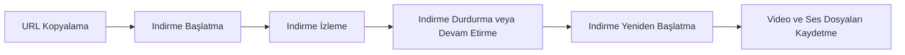

<div align="center">

**YouTube ve diğer videoların kolay ve hızlı şekilde indirilmesini sağlar**

</div>

Downtube, kullanıcıların YouTube ve diğer videoların indirilmesini sağlar ve indirme işlemlerini yönetir. Proje, kullanıcıların videoları indirmek için kolay bir arayüz sunar ve indirme işlemlerini izleme, durdurma veya yeniden başlatma gibi işlemleri kolaylaştırır.

<p align="center">
  
</p>

<details>
<summary><b>📋 İçindekiler</b></summary>

- [✨ Özellikler](#-özellikler)
- [⚙️ Nasıl Çalışır](#-nasıl-çalışır)
- [📦 Kurulum](#-kurulum)
- [🚀 Kullanım](#-kullanım)
- [📁 Proje Yapısı](#-proje-yapısı)
- [🤝 Katkıda Bulunma](#-katkıda-bulunma)
- [👤 Geliştirici](#-geliştirici)

</details>

## ✨ Özellikler

### 📹 Video ve Ses Dosyaları

- MP4, M4A ve WebM formatlarını destekler
- Ses ve video kalitesi seçilebilir
- Medya depolama alanına ve legacy medya depolama alanına kaydeder

### 📈 Indirme İşlemleri

- Video ve ses dosyalarını indirir
- Indirmeyi durdurabilir veya devam ettirebilir
- Indirmeyi yeniden başlatabilir
- Indirme ilerlemesini gösterir
- Indirme hızı ve bekleme süresini izler

### 🔗 URL İşlemleri

- Kullanıcı bir URL'yi kopyalar ve indirmeyi başlatabilir
- Kullanıcı indirme işlemlerini izleyebilir ve durdurabilir
- Kullanıcı indirme işlemlerini yeniden başlatabilir


## ⚙️ Nasıl Çalışır



1. **URL Kopyalama** — Kullanıcı bir YouTube veya diğer videoların URL'sini kopyalar
2. **Indirme Başlatma** — Downtube, kullanıcının kopyaladığı URL'den videoyu indirir
3. **Indirme İzleme** — Kullanıcı, indirme ilerlemesini ve hızını izler
4. **Indirme Durdurma veya Devam Etirme** — Kullanıcı, indirmeyi durdurabilir veya devam ettirebilir
5. **Indirme Yeniden Başlatma** — Kullanıcı, indirmeyi yeniden başlatabilir
6. **Video ve Ses Dosyaları Kaydetme** — Downtube, indirilen video ve ses dosyalarını medya depolama alanına veya legacy medya depolama alanına kaydeder

| Bileşen | Görev |
| --- | --- |
| `app` | Kullanıcı arayüzünü sunar ve kullanıcının işlemleriyle iletişim kurar |
| `downloader` | Videoların indirilmesini yönetir ve kontrol eder |
| `media-manager` | Indirilen video ve ses dosyalarını medya depolama alanına veya legacy medya depolama alanına kaydeder |

## 📦 Kurulum

**Gereksinimler:** Java (JDK)

```bash
# Repoyu klonlayın
git clone https://github.com/Burakcnz/Downtube.git
cd Downtube

# Derleyin
./gradlew build
```

## 🚀 Kullanım

```bash
./gradlew run
```

#### Video İndirmek

1. YouTube veya diğer videoların URL'sini kopyalar
2. Downtube'u açar
3. URL'yi Downtube'a yapıştırır
4. Indirmeyi başlatır
5. Indirme ilerlemesini izler
6. Indirmeyi durdurmak veya devam ettirmek için ilgili düğmeye tıklar
7. Indirme tamamlandığında, video ve ses dosyalarını medya depolama alanına veya legacy medya depolama alanına kaydeder

## 📁 Proje Yapısı

```text
├── app/     # Bu bölüm, kullanıcıların YouTube ve diğer videoların indirilmesini…
│   ├── src/
│   └── build.gradle.kts
├── gradle/
│   ├── wrapper/
│   └── libs.versions.toml
├── build.gradle.kts
├── gradle.properties
├── gradlew
├── gradlew.bat
├── local.properties
└── settings.gradle.kts
```

## 🤝 Katkıda Bulunma

Katkılarınızı bekliyoruz! Şu adımları izleyin:

1. Repoyu fork'layın
2. Yeni bir dal oluşturun (`git checkout -b ozellik/yeni-ozellik`)
3. Değişikliklerinizi commit'leyin (`git commit -m 'Yeni özellik ekle'`)
4. Dalınızı push'layın (`git push origin ozellik/yeni-ozellik`)
5. Bir Pull Request açın

## 👤 Geliştirici

<p align="center">
  <a href="https://github.com/Burakcnz"></a>
  <br />
  <b>Burak Can Zengin</b> · <a href="https://github.com/Burakcnz">@Burakcnz</a>
</p>

<p align="center"><a href="https://github.com/Burakcnz/Downtube">⭐ Projeyi beğendiyseniz yıldız vermeyi unutmayın!</a></p>


